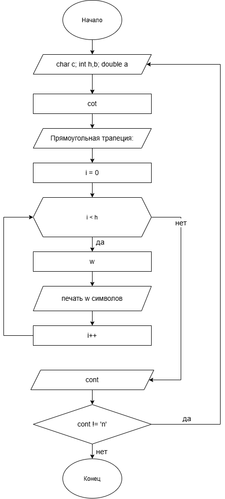

# Домашнее задание к работе номер 9

## Условие задачи

Написать программу, выводящую на экран заданную геометрическую фигуру, нарисованную с помощью заданного с клавиатуры символа, условие заполнения фигуры и задаваемые параметры фигуры в таблице.

## 1. Алгоритм и блок-схема

### Алгоритм

1. Начало.

2. Объявить переменные:
 \
**c** - символ для фигуры\
**h** - высота\
**b** - верхнее основание трапеции\
**a** - угол

3. С помощью циклов do-while и for осуществить вывод фигуры в консоль и возможность повторного взаимодействия с программой.

4. Конец.

### Блок-схема



## 2. Реализация программы

```c
#define _CRT_SECURE_NO_WARNINGS
#define _USE_MATH_DEFINES
#include <stdio.h>
#include <math.h>
#include <locale.h>
#define M_PI 3.14159265358979323846

int main(void)
{
    char c, cont;
    int h, b, i, j, w;
    double a, cot;

    setlocale(LC_CTYPE, "RUS");

    do {
        printf("Введите символ:\n");
        scanf(" %c", &c);

        printf("Введите высоту h:\n");
        scanf("%d", &h);

        printf("Введите верхнее основание b:\n");
        scanf("%d", &b);

        printf("Введите угол a:\n");
        scanf("%lf", &a);

        cot = 1. / tan(a * M_PI / 180.);

        printf("Прямоугольная трапеция:\n\n");

        for (i = 0; i < h; i++) {
            w = b + (int)floor(i * cot + 0.5);

            for (j = 0; j < w; j++)
                putchar(c);
            putchar('\n');
        }

        printf("\nПродолжить? (Да - введите y, Нет - введите n)\n");
        scanf(" %c", &cont);
    } while (cont != 'n');

    return 0;
}
```

## 3. Результаты работы программы

Пример:\
 \
Введите символ:\
*\
Введите высоту h:\
6\
Введите верхнее основание b:\
5\
Введите угол a:\
45\
Прямоугольная трапеция:

*****\
******\
*******\
********\
*********\
**********\
 \
Продолжить? (Да - введите y, Нет - введите n)\
n

## 4. Информация о разработчике

Литуновский Максим Дмитриевич, бТИИ-261
